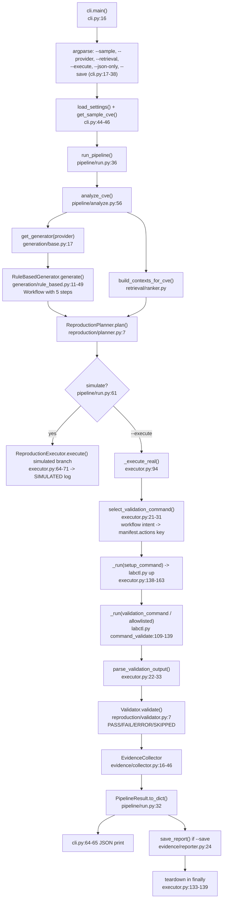

# T5 end-to-end audit — Batch 0 + Batch 1 (2026-11-22)

Baseline: `dev` @ `4283360` + uncommitted provenance batch. Audit only: no source
change, no commit/push, no Kaggle interaction, no training, no Docker run this batch.

## 1. Git state at start and end

| Item | Value |
|---|---|
| Branch | `dev...origin/dev` |
| HEAD | `4283360 Drive lab validation from allowlisted workflow actions` |
| Modified tracked | 7 files from the earlier provenance batch (domain/evidence.py, domain/workflow.py, evidence/collector.py, generation/t5.py, pipeline/run.py, tests/integration/test_docker_lab.py, tests/unit/test_executor.py) |
| Untracked | `docs/evaluation/`, `docs/human-evaluation/`, `docs/paper-deviation-report-vi.md`, `reports/`, `tests/unit/test_evidence_provenance.py` |
| After this batch | unchanged; only new files under `reports/execution/` |

Both changes were pre-existing and preserved. No file outside `reports/execution/` was written.

## 2. Execution flow (actual source)



## 3. Data-flow verification (exact files/symbols)

| Question | Answer | Source |
|---|---|---|
| CVE input read where? | `get_sample_cve(args.sample)` from `connectors/samples.py`, default `CVE-2024-0001` | `cli.py:18,46` |
| Workflow created where? | `analyze_cve()` → `get_generator("rule_based")` → `RuleBasedGenerator.generate()` | `pipeline/analyze.py:56-73`, `generation/rule_based.py:11-49` |
| Which workflow is executed? | The `Workflow` returned by the provider; planner converts its steps to `PlanStep` 1:1 | `pipeline/run.py:47`, `reproduction/planner.py:11-22` |
| Which action from manifest? | `select_validation_command()` maps step text to `manifest.actions` key; argv comes from `manifest.actions` or `manifest.validation_command` | `executor.py:21-31,108-124` |
| Which validator? | `labs/cve-001/validation/labctl.py:command_validate` invoked via manifest `validation_command` | `labs/cve-001/lab.yaml:10`, `labctl.py:109-139` |
| Evidence collected? | generation dict, workflow dump, plan dump, checkpoint_id, execution log, validation result | `pipeline/run.py:69-86`, `collector.py:16-46` |
| PASS/FAIL/SIMULATED decided where? | `Validator.validate()` maps `execution.simulated`, `execution.error`, or validator payload status | `validator.py:7-63` |
| Teardown? | `finally` block runs `manifest.teardown_command` on success and failure | `executor.py:133-139` |

Fresh CLI smoke (no Docker):
```
python -m vuln2action.cli --list-samples
python -c "...--json-only..."  ->
STATUS: SIMULATED PROVIDER: rule_based STEPS: 5
EVIDENCE_KEYS: ['checkpoint_id','collected_at','command_outputs','generation','http','logs','plan','validation_result','workflow']
```

## 4. Security audit

| Check | Finding | Source / command | Status |
|---|---|---|---|
| No `shell=True` | zero matches in `src/vuln2action/**/*.py`, `api/**/*.py` | `Select-String 'shell\s*=\s*True'` | VERIFIED |
| Manifest-only argv | `select_validation_command` returns command dict/list from manifest; `_run` never uses step text as argv | `executor.py:21-31,138-163` | VERIFIED |
| Localhost guard | non-local target raises before subprocess; test with monkeypatched `subprocess.run` asserts zero calls | `test_executor.py:test_executor_refuses_non_local_target_before_running` | VERIFIED |
| Allowlist active | rule-based steps "Inspect target service" → key `probe` → `manifest.actions["probe"]`; log line `[workflow] step ... selected allowlisted action ...` | `executor.py:108-117`, `test_live_lab_uses_allowlisted_action_only` | VERIFIED |
| Validator checks result | vulnerable must reflect unescaped marker, patched must reflect escaped and must NOT reflect unescaped | `labctl.py:114-128` | VERIFIED |
| Negative counterfactual | temp lab copy with patched app reflecting unescaped marker yields FAIL | `test_broken_patched_counterfactual_is_not_pass` (historical pass) | VERIFIED historical |
| Positive counterfactual | validator requires both sides | `test_live_lab_produces_a_real_pass` (historical pass) | VERIFIED historical |
| Teardown on success/failure | `finally` + `if: always()` plan | `executor.py:133-139`, `reports/ci-lab-integration-plan.md` | VERIFIED source |
| No leftover containers | `docker ps --filter name=vuln2action-cve-001` assertion | `test_live_lab_teardown_removes_containers` (historical pass) | VERIFIED historical |
| Docker run this batch | not executed to avoid port/container interference | — | NOT EVALUATED |

## 5. Definition of Done for T5 demo

| # | Requirement | Status | Evidence / gap |
|---|---|---|---|
| 1 | Input CVE rõ ràng | VERIFIED | `--sample CVE-2024-0001`, sample JSON |
| 2 | Execution log | VERIFIED source | `executor._run` appends command + exit; fresh SIMULATED log |
| 3 | Workflow + nguồn | VERIFIED | `provider=rule_based`, 5 steps, `workflow` in evidence |
| 4 | Manifest/action evidence | VERIFIED source + test | `[workflow]` selection line assertion |
| 5 | Docker lab result | VERIFIED historical | 6 Docker tests passed earlier; not rerun this batch |
| 6 | Validator result | VERIFIED historical | `V2A_VALIDATION_JSON` payload, FAIL assertion |
| 7 | Negative counterfactual | VERIFIED historical | temp lab copy test |
| 8 | EvidenceBundle | VERIFIED fresh | evidence keys listed above |
| 9 | report.json | VERIFIED source | `reporter.save_report` writes JSON+MD; need actual demo run artifact |
| 10 | Screenshot | NOT DONE | no screenshot captured; `SCREENSHOT_NOT_CAPTURED` until Batch 3 |
| 11 | Có thể giải thích tái lập | VERIFIED | commands in `docs/README.md` + this report |

DoD conclusion: T5 **logic and source path are complete**; demo artifact packaging
(items 9-10) is the remaining implementation work for Batch 3. T5 itself can run
end-to-end with `--execute` when Docker is available.

## 6. Fresh checks this batch

| Command | Result |
|---|---|
| `git status --short --branch`, `git log -1 --oneline`, `git diff --stat`, `git diff` | captured above |
| `python -m ruff check src api scripts tests evaluation gui` | exit 0 |
| `python -m pytest -q` | 248 passed, 6 skipped, exit 0 |
| `python -m vuln2action.cli --list-samples` | 3 sample CVEs printed |
| `--sample CVE-2024-0001 --json-only` | SIMULATED, rule_based, 5 steps, 9 evidence keys |

Docker opt-in was **not** run in this batch (per constraint). No Kaggle access.

## 7. What must be fixed/prepared (Batch 2/3 only)

1. Create `artifacts/demo/cve-001/` with `input/`, `workflow/`, `execution/`,
   `validator/`, `evidence/`, `logs/`, `screenshots/`, `report.json`, `manifest.json`
   from **one real run** using `--execute --save`.
2. Capture screenshot from GUI/CLI; if tooling cannot capture, write
   `SCREENSHOT_NOT_CAPTURED` plus manual instructions — never fake it.
3. Keep `--execute` output and `V2A_VALIDATION_JSON` line as the PASS proof.
4. No source change appears necessary for the demo path itself; if Batch 3 finds a
   real defect, fix minimally and add a test.

## 8. Blockers requiring user decision

- **Kaggle artifact**: unavailable; T1/T7 remain BLOCKED (no access this batch).
- **Docker run permission for demo**: user must confirm that building `cve-001`
  images and binding 127.0.0.1:18001/18011 is acceptable before Batch 3.
- **Screenshot tooling**: if none available, accept `SCREENSHOT_NOT_CAPTURED`.

## 9. Stage status

Batch 0: VERIFIED (state captured). Batch 1: VERIFIED for source trace and security
boundary; PARTIALLY VERIFIED for demo evidence (screenshot/report artifact missing);
NOT EVALUATED for Docker run in this batch. No implementation was performed.
