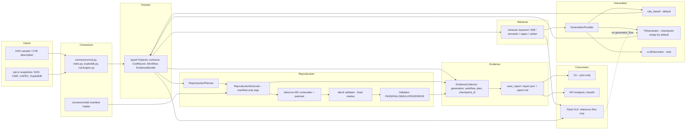

# Current architecture — implementation reality (2026-11-22)

This diagram reflects source code, not the README's intended design.

## Boundary rules verified in source

- `GenerationProvider` (`generation/base.py:9-15`) returns `Workflow`; pipeline
  depends only on this interface (`pipeline/analyze.py:63-65`).
- Generated text never becomes argv: `reproduction/executor.py:21-31` maps workflow
  intent to a key in `manifest.actions`; `_run` (`executor.py:138-163`) executes
  only the manifest list, `check=False`, no shell.
- Host guard: `is_allowed_target` (`executor.py:17-19`) and `execute()` check before
  any subprocess; non-local targets raise.
- `cve-002/003` manifests are `placeholder`; executor refuses them
  (`executor.py:85-86`).

## Intended vs actual

| README / design | Actual code | Gap |
|---|---|---|
| "GUI to search attack steps and exploits" | GUI shows CAPEC reference flow + technique→ExploitDB descriptions | No T5-generated flow, no validation result display |
| "Optional FastAPI" | routes exist but no `response_model`; `/results` returns raw JSON | no contract enforcement |
| "Generation abstraction rule/LLM/T5" | interface exists; LLM is stub; T5 checkpoint empty | fine-tuned model not wired by default |
| "Workflow → lab reproduction" | planner→executor exists; validator uses fixed marker | workflow does not determine validation payload |
| "Evidence collection" | generation/workflow/plan/checkpoint_id stored | checkpoint_id is a string, not a digest |
| "Local Flask GUI + generated flow" | reference flow only | primary demo gap |

## Data flow caveat

The paper-scale dataset is not present in this checkout. The diagram's `RAW` node
is opt-in and, on this machine, only `data/raw/cwe` and `data/raw/capec` exist;
`data/raw/nvd` does not. Retrieval therefore reads local MITRE XML when present,
which changes semantic P@3 from the README's 0,296 to 0,3333
(`retrieval/semantic.py:236-240`).
