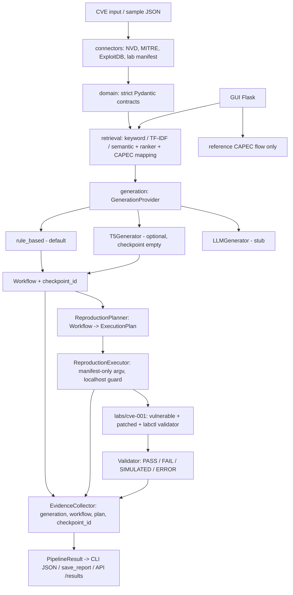

# Full project audit — Vuln2Action-Lab (2026-11-22)

## 1. Executive summary

Dự án có nền tảng kỹ thuật vững: package typed, CLI, CI trên `dev`, retrieval,
CAPEC mapping, rule-based generation, lab `cve-001` với validator thật và evidence
có provenance. Đây **không còn là scaffold**.

Tuy nhiên, mục tiêu nghiên cứu cốt lõi — chứng minh workflow do T5 sinh ra điều
khiển việc tái hiện và được lab xác nhận — **chưa hoàn thành**. Kernel Kaggle stage 1
được báo là đang chạy; trong phạm vi audit này không truy cập Kaggle, không có
`metrics.json`/checkpoint stage 1 để xác minh. Dataset paper-scale không có trong
Git tree và không có local (`data/processed/reproduction` = False), nên mọi số
liệu 114.560/89.311/55.420 chỉ là **tài liệu báo cáo**, không phải dữ liệu đếm
được trong phiên audit.

Mức hiện thực hóa paper: **phần lớn pipeline được cài đặt, nhưng đánh giá khoa học
chưa khép kín**. Có 4 rủi ro nghiêm trọng: leakage validation 11.083/11.089,
benchmark 120 CVE circular, T5 collapse ở mọi run đã báo cáo, và GUI chỉ hiện
reference flow. CI xanh không chứng minh labintegration (job Docker chưa bật).

## 2. Scope và phương pháp audit

- Đối tượng: repo tại `dev`, HEAD `4283360` + batch uncommitted (7 file source/test
  đã đổi, 1 test mới, 4 nhóm path untracked).
- Không commit/push, không checkout/reset/clean, không sửa source/dataset/GUI/schema,
  không chạy training, không đụng Kaggle, không bật Docker CI, không chạy Docker test
  trong phiên này (rủi ro port/container), không xóa/ghi đè báo cáo cũ.
- Lệnh đã chạy: `git status`, `git log`, `git ls-files`, `git diff`, `ruff check`,
  `compileall`, `pytest -q`, đọc source/config/docs/test/report.
- Evidence standard: VERIFIED / PARTIALLY VERIFIED / NOT VERIFIED / NOT IMPLEMENTED
  / BLOCKED / NOT EVALUATED.

## 3. Architecture thực tế

Khác với README: `GenerationProvider` đúng là abstraction; nhưng GUI **không** gọi
pipeline/T5; API scaffold; `models.yaml` để `checkpoint: ""`, `device: cpu`;
`enabled` của provider không được `get_generator` kiểm tra (`generation/base.py:17`).

## 4. Component-by-component audit

| Thành phần | Trạng thái | Bằng chứng | Giới hạn |
|---|---|---|---|
| Package, CLI, contracts | VERIFIED | `src/vuln2action/`, `cli.py:64-65`, `domain/*.py`; pytest xanh | — |
| Config & logging | VERIFIED | `config/settings.yaml`, `models.yaml`, `utils/logging.py` | `enabled` flag không được factory dùng |
| Retrieval backends | VERIFIED | `retrieval/keyword.py`, `tfidf.py`, `semantic.py`, `ranker.py`; tests retrieval | neural embeddings là stub |
| CAPEC mapping | VERIFIED implementation | `retrieval/capec.py`, `scripts/select_capec.py`, `mapping/` | kết quả 87/100 chỉ có trong docs |
| Rule-based generation | VERIFIED | `generation/rule_based.py:20`, `test_generation.py` | output là script lab, không phải attack prose |
| T5 generation code | PARTIALLY VERIFIED | `generation/t5.py:204-307`, `train_t5.py`, `test_generation_t5.py` | checkpoint paper-scale chưa có; GUI không dùng |
| LLM provider | NOT IMPLEMENTED | `generation/llm.py:10` raises/stub | — |
| Planner/executor/validator | VERIFIED | `reproduction/*.py`, `test_executor.py`, `test_docker_lab.py` | lab action keys cùng validator |
| Lab `cve-001` | VERIFIED | `labs/cve-001/lab.yaml:status=ready`, `labctl.py:109-139` | marker cố định |
| Lab `cve-002/003` | NOT IMPLEMENTED | `lab.yaml:status=placeholder` | không dùng được |
| Evidence plumbing | VERIFIED | `domain/evidence.py`, `evidence/collector.py`, `pipeline/run.py:70-86` | checkpoint_id là string, không phải hash |
| GUI | PARTIALLY VERIFIED | `gui/app.py:56,110-150`, `test_gui.py` | chỉ reference flow |
| API | PARTIALLY VERIFIED | `api/main.py`, `routes/*.py` | scaffold, `/results` trả JSON thô |
| CI | VERIFIED | `.github/workflows/ci.yml`, run #6 success (lịch sử) | job Docker chưa bật |
| SBERT retrieval | NOT IMPLEMENTED | không có symbol SBERT trong pipeline | — |
| Human evaluation | BLOCKED | `docs/human-evaluation/` là candidate package | thiếu splits.json + outputs |

## 5. Dataset và model evaluation

| Số liệu | Trạng thái | Evidence |
|---|---|---|
| 114.560 CVE, 89.311 có CWE, 96.368 CVE-CWE | NOT VERIFIED | `data/processed/reproduction` absent; chỉ có trong `docs/paper-reproduction.md` |
| 55.420 flow rows, 176 CAPEC | NOT VERIFIED | cùng lý do |
| 665 techniques / 45.538 ExploitDB, cosine 0,8907 | NOT VERIFIED | `docs/stage2-exploit-mapping-report-vi.md` |
| CAPEC 86/100, 87/100 | PARTIALLY VERIFIED | script + benchmark file tracked; output chỉ có trong docs |
| Independent 21 case, Top-1 0,3333/0,1905 | PARTIALLY VERIFIED | `evaluation/datasets/capec_independent.json` tồn tại, hash freeze; metric là docs/analysis.md |
| Retrieval P@3 0,296 vs 0,3333 | VERIFIED environment difference | `retrieval/semantic.py:236-240` đọc raw XML nếu có; local `data/raw/cwe|cape` = True |
| Local toy T5 run | VERIFIED artifact | `models/t5-capec-flows/training_summary.json`: t5-small, 120 steps, 148 records — **không phải paper stage 1** |
| Kaggle stage 1 metrics/checkpoint | BLOCKED / NOT EVALUATED | repo/docs có cấu hình, không có artifact; audit không truy cập Kaggle |

BLEU: 0,1640/0,2567 CVE-only, 0,8594 CAPEC-conditioned, 0,7508 hybrid —
đều là số liệu **lịch sử trong docs**, setups khác nhau, không so được với 0,7589
của paper. Validation overlap 11.083/11.089 làm BLEU không phải generalization.

## 6. Docker lab và execution safety

- `cve-001`: vulnerable + patched, validator PASS chỉ khi vulnerable phản chiếu marker
  không escape **và** patched escape đúng (`labctl.py:123-128`).
- Executor: `select_validation_command` (`executor.py:21`) chỉ chọn key trong
  `manifest.actions`; argv luôn từ manifest; `shell=True` không xuất hiện; target
  ngoài localhost bị chối trước subprocess (`test_executor.py` guard test).
- Positive test: `test_live_lab_produces_a_real_pass` — historical pass trong batch
  trước, **không chạy lại trong audit này**.
- Negative test: `test_broken_patched_counterfactual_is_not_pass` — historical FAIL
  trên bản copy app patched bị sửa, không phải đúng logic validator.
- Phân biệt: test logic (unit) VERIFIED; Docker integration tests PASS historical;
  end-to-end reproduction với T5-generated flow **NOT IMPLEMENTED**; evidence-backed
  validation của rule-based workflow VERIFIED.

## 7. Evidence provenance và schema compatibility

- `GeneratedFlow.checkpoint` → `flow_to_workflow(checkpoint_id=...)` → `Workflow.checkpoint_id`
  → `EvidenceBundle.checkpoint_id` (`generation/t5.py:296-307`, `pipeline/run.py:70-86`).
- Round-trip và old-artifact load có test (`tests/unit/test_evidence_provenance.py`).
- `checkpoint_id` là chuỗi, **không phải cryptographic hash** — không gọi là provenance xác thực weights.
- `extra="forbid"` trên cả 2 model; old strict external consumer reject JSON mới
  (`reports/public-schema-compatibility-audit.md`: `OLD_STRICT_READS_NEW: NO -> ValidationError`).
- External consumers: NOT EVALUATED.

## 8. CI/testing

| Check | Kết quả audit fresh |
|---|---|
| `ruff check src api scripts tests evaluation gui` | exit 0 |
| `ruff check .` | exit 1, 5 lỗi cũ trong `labs/` (RUF100×2, PLW1510×3) |
| `compileall` | exit 0 |
| `pytest -q` | 248 passed, 6 skipped |
| Docker opt-in | historical 6 passed/50,58s; **không rerun trong audit** |
| CI job Docker | NOT IMPLEMENTED (plan only) |

## 9. Paper comparison

| Nhóm | Hạng mục |
|---|---|
| Implemented | ingestion opt-in, retrieval TF-IDF/Word2Vec, CAPEC candidate + ranking, rule-based generation, T5 adapter, Flask GUI read-only, localhost lab, evidence |
| Partially implemented | T5 paper-scale training (code có, artifact chờ), stage-2 description mapping (chưa SBERT), GUI generated flow, checkpoint provenance (string), group-split plan |
| Deviated | A100 → T4 x2, 50 epoch → 5/10, 3 experts → 1 advisor, 1.024 CAPEC → 176, benchmark circular |
| Not implemented | SBERT retrieval, Stage 2 CVE-only, FLAN-T5 paper-scale, human evaluation scores, cve-002/003, Docker CI job |
| Not comparable | CVE-only 0,1640/0,2567; CAPEC-conditioned 0,8594; hybrid 0,7508 so với paper 0,7589 |
| Not evaluated | Kaggle run hiện tại, external schema consumers, GitHub-hosted Docker job |

## 10. Critical findings

1. T5 paper-faithful chưa có artifact/metrics — lõi paper chưa chứng minh (BLOCKED).
2. Validation leakage 11,083/11,089 — BLEU hiện tại là upper bound (`docs/t5-stage1-eval-vi.md:51`).
3. Benchmark 120 CVE circular — Top-1 87/100 không đo ranking (`docs/analysis.md:16-30`).
4. T5 collapse: 25 unique predictions/11.089 rows (`docs/t5-stage1-paper10-eval-vi.md:47-51`).
5. GUI chỉ reference flow — demo không phân biệt generated/reference (`gui/app.py:147`).
6. Hai action lab cùng validator marker cố định — chưa chứng minh payload do workflow sinh.
7. CI xanh nhưng Docker lab không được CI kiểm chứng.
8. Dataset paper-scale không có trong repo/máy này — clone sạch không tái lập được số liệu.
9. `checkpoint_id` không phải hash; strict schema external có thể reject JSON mới.
10. `ruff check .` đỏ 5 lỗi `labs/` dù CI scope xanh.

## 11. Release/readiness assessment

Sẵn sàng cho **demo nội bộ có điều kiện**: rule-based pipeline + lab XSS + evidence.
Chưa sẵn sàng cho **bảo vệ như paper reproduction**: thiếu kết quả T5 cuối, holdout
sạch, human eval, SBERT, stage 2, và khả năng clone-and-verify từ repo.

## 12. Việc cần giải quyết trước khi bảo vệ

1. Có `metrics.json`/checkpoint Kaggle và ghi đúng 5 epoch/FP32/T4 x2.
2. Tạo holdout group-split trước khi trích BLEU generalization.
3. Xin `splits.json`, sinh 20 workflow, gửi advisor; báo 1 reviewer.
4. Nối generated flow vào GUI với nhãn nguồn rõ ràng.
5. Viết báo cáo sai lệch, đóng băng independent benchmark bằng hash.
6. Quyết định có bật Docker CI job sau một run GitHub xanh.

## 13. Điều tuyệt đối không được tuyên bố khi chưa có bằng chứng

- "Đã reproduce paper" / "BLEU 0,7589".
- "T5 workflow tái hiện thành công lỗ hổng" (khi lab vẫn dùng marker cố định).
- "3 chuyên gia đánh giá" / "human evaluation hoàn thành".
- "SBERT retrieval đã làm" / "Stage 2 xong" / "50 epoch hoàn thành".
- "CI đã kiểm chứng PASS/FAIL" (job Docker chưa bật).
- "Dataset 114.560 có thể kiểm chứng từ repo" (không có trong Git/máy này).
- "Checkpoint_id là cryptographic provenance".
- "BLEU validation là generalization".
