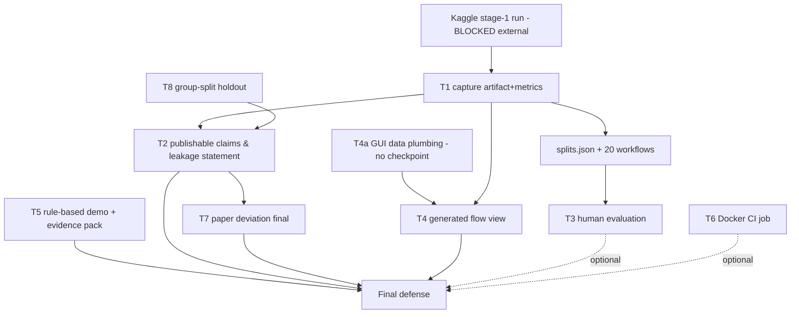

# Next action roadmap — Vuln2Action-Lab (2026-11-22)

## 1. Executive recommendation

Việc quan trọng nhất **ngay lúc này** là chốt artifact Kaggle stage 1 (metrics,
checkpoint, log) và trong lúc chờ thì **khóa phạm vi claims được phép công bố**: chỉ
báo cáo số liệu có artifact, tách riêng CVE-only / CAPEC-conditioned / hybrid.
Lý do: audit xác nhận phần engineering đã chạy được, nhưng tuyên bố cốt lõi của
paper vẫn chưa có bằng chứng tại repo. Chưa nên làm SBERT, thêm lab, tăng epoch hay
viết lại hệ thống — chúng không giải nút thắt evaluation. Blocker hiện tại: kernel
Kaggle (không được can thiệp), `splits.json`/workflow cho human eval, và thiếu
holdout sạch. Nếu không có checkpoint, dự án vẫn có thể bảo vệ ở mức **minimum
defensible** bằng rule-based pipeline + lab `cve-001` + evidence, với limitations
nói rõ.

## 2. Current state

| Component | Status | Evidence | Gap | Priority |
|---|---|---|---|---|
| Package/CLI/contracts | VERIFIED | audit matrix A1-A2, pytest 248/6 | — | — |
| CI trên dev | VERIFIED | `.github/workflows/ci.yml:3-8`, run #6 | Docker job chưa bật | P2 |
| Retrieval + CAPEC mapping | VERIFIED implementation | `retrieval/*.py`, `scripts/select_capec.py` | số liệu chỉ docs; benchmark circular | P1 |
| Rule-based generation | VERIFIED | `generation/rule_based.py:20` | — | — |
| T5 generation code | PARTIALLY VERIFIED | `generation/t5.py:204-307` | checkpoint paper-scale chưa có | P0 |
| Dataset paper-scale | NOT VERIFIED | `data/processed/reproduction` absent | không tái lập từ clone | P1 |
| Lab `cve-001` | VERIFIED | `lab.yaml:ready`, `labctl.py` | marker cố định | P1 |
| Lab `cve-002/003` | NOT IMPLEMENTED | `lab.yaml:placeholder` | bỏ qua được | P3 |
| Evidence + checkpoint_id | VERIFIED | `domain/evidence.py`, `test_evidence_provenance.py` | string, không phải hash | P2 |
| GUI | PARTIALLY VERIFIED | `gui/app.py:147` | reference flow only | P1 |
| Human eval | BLOCKED | `docs/human-evaluation/` | thiếu split + outputs | P1 |
| Docker CI | NOT IMPLEMENTED | `reports/ci-lab-integration-plan.md` | chưa bật | P2 |
| SBERT / Stage 2 | NOT IMPLEMENTED | grep không thấy symbol | research extension | P3 |

### 2.1 Answers to specific questions

**A. Project status.** Đã hoàn thành: package, contracts, CI, retrieval, CAPEC scripts,
rule-based generation, planner/executor/validator, lab `cve-001`, evidence plumbing,
5 Docker assertions (historical). Có implementation nhưng chưa evaluation: T5 adapter,
stage-2 description mapping, API scaffold, checkpoint provenance. Chỉ documentation:
114.560 dataset stats, BLEU 0,1640/0,2567/0,8594/0,7508, human-eval protocol.
Placeholder: LLM provider, neural embeddings, `cve-002/003`, reproduction evaluation
stub. Có thể đưa vào báo cáo: kết quả test fresh (248/6), CI run #6, code paths đã
verify, independent benchmark artifact có hash, lab PASS/FAIL historical. Chưa đủ
điều kiện công bố: mọi số dataset/BLEU chưa có artifact local, human eval scores.

**B. Research validity.** Benchmark 120 CVE **không độc lập** (circular). Leakage
11,083/11.089 làm BLEU không đại diện generalization. Human evaluation là blocker
cho Level 2, **không phải blocker cho Level 1** nếu báo rõ chưa có. Group-split
**không bắt buộc trước khi bảo vệ Level 1**, nhưng bắt buộc nếu trích bất kỳ con số
"generalization". T5 hiện tại **không chứng minh generalization**. Nên ưu tiên
hoàn thiện evaluation (protocol + artifact) hơn cải thiện model.

**C. Model/Kaggle.** Chờ checkpoint: GUI generated flow, stage-2, BLEU/ROUGE cuối,
README checkbox. Không cần chờ: demo rule-based, lab evidence, freeze benchmark,
protocol group-split, draft báo cáo, human-eval form. Sau khi có checkpoint: lưu
artifact + config + hash, điền `PENDING KAGGLE ARTIFACT`, quyết định công bố số nào,
rồi mới nối GUI. Không restart/cancel kernel.

**D. Docker lab.** `cve-001` chứng minh môi trường vulnerable/patched và validator
chạy thật, có positive/negative historical. `cve-002/003` thiếu app, compose thật,
validator — không tính. Validator đủ cho mức demo nhưng marker cố định nên chưa
chứng minh payload do workflow sinh. Nên làm chắc `cve-001` trước; không thêm lab mới.
Điều kiện bật Docker CI: assertions đã có + một run GitHub-hosted xanh + cleanup xác nhận.

**E. Evidence/schema.** `checkpoint_id` là chuỗi định danh, **không phải hash weights**.
Để xác minh cần artifact digest/model card id — không làm trong Level 1. Có thể trì
hoãn public schema release; demo nội bộ không block bởi strict consumer. Schema
version/compatibility export là việc Level 2/3.

**F. GUI/demo.** GUI hiện thể hiện **reference CAPEC flow** (`_flow_view`), không có
generated flow; người xem **không phân biệt** được nếu không giải thích miệng. Demo
nên đi: CVE input → retrieval/CAPEC → rule-based workflow → plan → lab up/validate/down
→ evidence JSON/PASS → dòng limitation. Cần screenshot CLI JSON, `report.json`, log
validator có `V2A_VALIDATION_JSON`, và ảnh GUI có nhãn "reference".

## 3. Minimum defensible project (bắt buộc)

| Task | Bắt buộc vì |
|---|---|
| T1 chốt artifact Kaggle hoặc ghi rõ BLOCKED | tránh công bố số không có bằng chứng |
| T2 khóa evaluation claims + leakage statement | tránh bị chất vấn generalization |
| T5 demo rule-based → lab → evidence | chứng minh hệ thống chạy thật |
| T7 hoàn thiện paper deviation report | trung thực về sai lệch |
| T6 (chỉ khi có run GitHub xanh) Docker CI | tăng độ tin cậy, không bắt buộc Level 1 |

## 4. Strong project (nếu còn thời gian)

- T3 human evaluation (cần split + workflow + advisor).
- T4 GUI tách reference/generated flow.
- T6 bật Docker CI job.
- T8 group-split manifest thật + metrics có artifact.
- T9 finalize provenance (digest, schema migration note).

## 5. Research extensions (có thể hoãn)

- SBERT retrieval + threshold study (P3).
- Stage 2 CVE-only chạy thật (P3, block bởi checkpoint).
- `cve-002`/`cve-003` lab (P3).
- FLAN-T5 paper-scale, thêm baseline, mở rộng dataset, ablation (P3).
- Không được để các task này trễ milestone bảo vệ.

## 6. Critical path

```text
Kaggle kernel kết thúc
  -> T1 artifact + metrics
  -> T2/T8 evaluation statement + holdout
  -> T7 báo cáo sai lệch hoàn chỉnh
  -> Final demo + defense

Song song (không chờ Kaggle):
  T5 demo script -> T4 GUI plumbing -> T6 CI plan验证 -> T3 chuẩn bị advisor
```

Nếu kernel không ra artifact: critical path chuyển sang "chốt Level 1 + limitations",
không chờ vô hạn.

## 7. Task dependency graph



## 8. Detailed tasks (15 fields each)

### T1 — Chốt artifact stage 1
1. ID: T1. 2. Tên: Capture stage-1 artifact. 3. Mục tiêu: có metrics/checkpoint/log thật. 4. Vấn đề: lõi paper chưa có bằng chứng. 5. Trạng thái: BLOCKED. 6. Ưu tiên: P0. 7. Lý do: mọi số BLEU phụ thuộc vào đây. 8. Dependency: kernel Kaggle tự kết thúc. 9. Files: `data/external/`, `docs/t5-stage1-*-vi.md`, `docs/paper-deviation-report-vi.md`. 10. Owner: Research Lead; reviewer: Core Engineer. 11. Effort: 0,5 ngày sau khi kernel xong. 12. AC: `metrics.json`, `predictions.jsonl`, `training_config.json`, checkpoint tồn tại; log ghi 5 epoch/FP32/T4 x2. 13. Evidence: file hash + timestamp + config. 14. Rủi ro: kernel fail/timeout → dùng negative result, không bịa số. 15. Gate tiếp theo: có artifact mới chuyển T2/T7.

### T2 — Khóa claims và leakage statement
1. ID: T2. 2. Tên: Publishable claims. 3. Mục tiêu: danh sách số được phép nói. 4. Vấn đề: trộn protocol/leakage. 5. Trạng thái: PARTIALLY VERIFIED (protocol docs có, artifact chưa). 6. Ưu tiên: P0. 7. Lý do: tránh chất vấn scientific validity. 8. Dependency: T1 cho số cuối; independent freeze đã có. 9. Files: `docs/paper-deviation-report-vi.md`, `docs/evaluation/*`. 10. Owner: Research Lead; reviewer: Integration Lead. 11. Effort: 0,5 ngày. 12. AC: bảng phân loại implemented/deviated/not comparable/not evaluated, kèm dòng 11,083/11,089 và 12/21. 13. Evidence: docs + hash benchmark. 14. Rủi ro: nói quá mức nếu không kỷ luật. 15. Gate: T7.

### T3 — Human evaluation
1. ID: T3. 2. Tên: Complete human eval. 3. Mục tiêu: 20 case có rubric và 1 reviewer. 4. Vấn đề: package mới ở mức candidate. 5. Trạng thái: BLOCKED. 6. Ưu tiên: P1. 7. Lý do: tăng credibility, không block Level 1. 8. Dependency: `splits.json`, 20 workflow outputs, advisor. 9. Files: `docs/human-evaluation/*`. 10. Owner: Research Lead; reviewer: Integration Lead. 11. Effort: 1 ngày + thời gian advisor. 12. AC: `cases.json` khớp `human_eval_20`, 20 output có checkpoint id, form đã gửi, score do advisor điền. 13. Evidence: split hash, form, reviewer declaration. 14. Rủi ro: advisor trễ → bỏ qua ở Level 1 với limitations. 15. Gate: chỉ đưa vào báo cáo khi có score thật.

### T4 — GUI tách nguồn flow
1. ID: T4. 2. Tên: Reference vs generated flow. 3. Mục tiêu: người xem phân biệt nguồn. 4. Vấn đề: GUI chỉ reference. 5. Trạng thái: PARTIALLY VERIFIED (plumbing plan có). 6. Ưu tiên: P1. 7. Lý do: demo dễ bị hiểu nhầm. 8. Dependency: T4a làm được ngay; phần generated chờ T1. 9. Files: `gui/app.py`, `gui/templates/index.html`, `tests/unit/test_gui.py`. 10. Owner: Integration Lead; reviewer: Core Engineer. 11. Effort: 0,5 ngày plumbing + 0,5 ngày wiring. 12. AC: API trả `reference_flow`, `generated_flow=null`, `generation_status`; template có nhãn nguồn; test pass. 13. Evidence: test_gui + screenshot. 14. Rủi ro: gán nhãn T5 cho reference flow — nghiêm cấm. 15. Gate: có checkpoint mới bật generated view.

### T5 — Demo rule-based + evidence
1. ID: T5. 2. Tên: Defensible demo. 3. Mục tiêu: chạy CVE→lab→evidence trước bảo vệ. 4. Vấn đề: chưa có kịch bản chuẩn. 5. Trạng thái: PARTIALLY VERIFIED (code+test có, script demo chưa đóng gói). 6. Ưu tiên: P1. 7. Lý do: là bằng chứng mạnh nhất hiện có. 8. Dependency: Docker local, không cần Kaggle. 9. Files: `scripts/run_pipeline.py`, `labs/cve-001/`, `results/`, `docs/`. 10. Owner: Integration Lead; reviewer: Research Lead. 11. Effort: 0,5 ngày. 12. AC: lệnh chạy được từ clone sạch, in PASS, `report.json` có generation/workflow/plan/checkpoint_id, teardown sạch. 13. Evidence: log CLI + report.json + ảnh GUI có nhãn. 14. Rủi ro: port conflict → chạy serial. 15. Gate: sẵn sàng Final.

### T6 — Docker CI job
1. ID: T6. 2. Tên: Enable lab CI. 3. Mục tiêu: CI kiểm chứng PASS/FAIL. 4. Vấn đề: CI xanh nhưng lab chưa được check. 5. Trạng thái: NOT IMPLEMENTED (plan có). 6. Ưu tiên: P2. 7. Lý do: không block Level 1. 8. Dependency: assertions local đã có; cần run GitHub-hosted. 9. Files: `.github/workflows/ci.yml`. 10. Owner: Core Engineer; reviewer: Integration Lead. 11. Effort: 0,5 ngày. 12. AC: job riêng `needs: quality`, V2A_DOCKER_TESTS=1, 6 test pass, teardown always. 13. Evidence: CI run URL. 14. Rủi ro: Ubuntu khác Windows → đỏ; không dùng continue-on-error. 15. Gate: một run xanh mới coi là xong.

### T7 — Paper deviation final
1. ID: T7. 2. Tên: Finalize deviation report. 3. Mục tiêu: báo cáo trung thực hoàn chỉnh. 4. Vấn đề: draft còn placeholder. 5. Trạng thái: PARTIALLY VERIFIED. 6. Ưu tiên: P1. 7. Lý do: hội đồng sẽ hỏi sai lệch. 8. Dependency: T1 + T2. 9. Files: `docs/paper-deviation-report-vi.md`. 10. Owner: Research Lead; reviewer: Integration Lead. 11. Effort: 0,5 ngày. 12. AC: không còn `PENDING KAGGLE ARTIFACT`, hoặc có dòng BLOCKED có lý do; bảng 14 dòng sai lệch đầy đủ. 13. Evidence: doc + artifact links. 14. Rủi ro: điền số tưởng tượng. 15. Gate: Final.

### T8 — Group-split holdout
1. ID: T8. 2. Tên: Leakage-free holdout. 3. Mục tiêu: protocol + manifest group-disjoint. 4. Vấn đề: 11,083/11,089 trùng. 5. Trạng thái: PLAN ONLY. 6. Ưu tiên: P2. 7. Lý do: cần nếu nói generalization. 8. Dependency: dataset snapshot có sẵn; không cần Kaggle để thiết kế. 9. Files: `docs/evaluation/t5-group-split-plan.md`, `evaluation/datasets/`. 10. Owner: Research Lead; reviewer: Core Engineer. 11. Effort: 1 ngày. 12. AC: manifest split có hash, overlap = 0, test cố định. 13. Evidence: script output + file hash. 14. Rủi ro: không retrain trong Level 1. 15. Gate: T2 nếu công bố generalization.

### T9 — Provenance digest (optional)
1. ID: T9. 2. Tên: Weight digest + schema migration note. 3. Mục tiêu: provenance mạnh hơn. 4. Vấn đề: checkpoint_id là string. 5. Trạng thái: NOT IMPLEMENTED. 6. Ưu tiên: P3. 7. Lý do: research extension. 8. Dependency: T1 artifact. 9. Files: `domain/evidence.py`, release note. 10. Owner: Core Engineer; reviewer: Research Lead. 11. Effort: 0,5 ngày. 12. AC: digest của checkpoint artifact được lưu; old artifact vẫn load. 13. Evidence: hash + test. 14. Rủi ro: đổi schema public — phải audit lại. 15. Gate: sau bảo vệ.

## 9. Team allocation (3 workstreams)

| Workstream | Primary owner (role) | Reviewer | Deliverable |
|---|---|---|---|
| Core engineering | Core Engineer | Research Lead | T6 Docker CI, T9 provenance (optional), guardrails |
| Research & evaluation | Research Lead | Core Engineer | T1 artifact, T2 claims, T3 human eval, T8 group-split |
| Integration & presentation | Integration Lead | Research Lead | T4 GUI separation, T5 demo pack, T7 report |

Không giả định tên hay lịch rảnh của cá nhân; vai trò là placeholder để nhóm tự gán.

## 10. Milestones (relative, không bịa deadline)

- **M1**: T5 demo chạy được + T2 claims được khóa (không cần Kaggle).
- **M2**: T1 artifact + T7 report final + T4 GUI plumbing.
- **M3**: T3 human eval (nếu advisor kịp) + T8 group-split + T4 wiring.
- **Final**: T6 Docker CI xanh trên GitHub + replay demo + freeze báo cáo.

Nếu không có ngày bảo vệ, dùng M1/M2/M3/Final làm điều kiện, không gán ngày.

## 11. Definition of Done (tóm tắt)

Xem `reports/definition-of-done.md`. Nguyên tắc: code ≠ tested ≠ evaluated ≠
reproducible ≠ demonstrable ≠ release-ready. Không mark DONE khi chỉ có source.

## 12. Demo plan

Xem `reports/demo-and-defense-checklist.md`. Kịch bản: CVE mẫu → CLI rule-based →
`SIMULATED` hoặc `--execute` PASS → `report.json` → GUI CAPEC reference flow (có
nhãn) → limitations nói rõ. Không demo T5-generated flow nếu chưa có checkpoint.

## 13. Risks & contingency

| Risk | Contingency |
|---|---|
| Kaggle không ra checkpoint | Chốt Level 1 + limitations; báo BLOCKED, không chờ vô hạn |
| Không có splits.json | Human eval ghi NOT EVALUATED; không tự tạo case |
| Strict schema consumer | Trì hoãn public release; demo nội bộ vẫn chạy |
| Docker CI khác local | Giữ job opt-in; không continue-on-error |
| GUI chưa generated flow | Hiện reference flow + nhãn rõ; không gán nhãn T5 |
| Leakage | Không trích BLEU như generalization; dùng independent set |

## 14. First 5 actions

1. **Chạy/đợi kernel Kaggle kết thúc rồi tải artifact (T1)** — Owner Research Lead; input: quyền Kaggle; output: `metrics.json` + checkpoint + log; AC: file tồn tại, 5 epoch/FP32/T4 x2 được ghi. Không restart kernel.
2. **Khóa danh sách claims được phép công bố (T2)** — Owner Research Lead; input: independent freeze + docs leakage; output: bảng claims trong `docs/paper-deviation-report-vi.md`; AC: không trộn 3 protocol, có dòng 11,083/11,089 và 12/21.
3. **Đóng gói demo rule-based → lab → evidence (T5)** — Owner Integration Lead; input: `scripts/run_pipeline.py`, lab cve-001; output: log CLI + `report.json` + screenshot; AC: PASS thật, teardown sạch, evidence có 4 field.
4. **Chuẩn bị GUI reference/generated separation (T4a)** — Owner Integration Lead; input: `gui/app.py`; output: API fields + test + template nhãn; AC: `generated_flow=null`, status rõ, test pass. Không giả lập output.
5. **Gửi yêu cầu `splits.json` và advisor review (T3)** — Owner Research Lead; input: dataset owner + lịch advisor; output: case list khớp split + form đã gửi; AC: có xác nhận nhận tài liệu. Nếu trễ → mark BLOCKED.

## Final honest answer

Nếu chỉ còn thời gian cho phần quan trọng nhất: **làm T5 demo + T2 claims trước**,
sau đó **T1 khi kernel xong và T7 báo cáo**, rồi **T4 GUI separation**; có thể bỏ qua
SBERT, stage 2, lab `cve-002/003`, FLAN-T5, model improvement và provenance digest mà
**không ảnh hưởng tính trung thực khoa học** — miễn không công bố BLEU thiếu artifact,
không gọi hybrid là CVE-only, và không nói đã reproduce paper.
