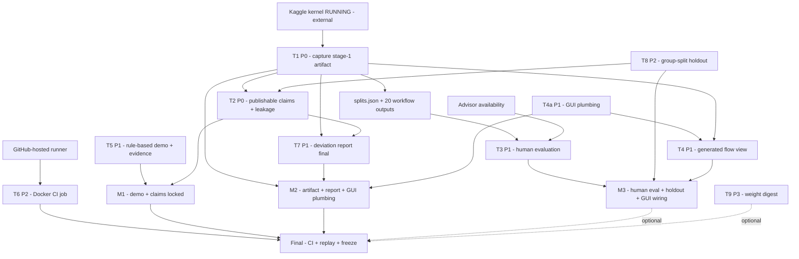

# Task dependency graph — next action roadmap

Nodes: external blockers (square-ish via quotes), tasks (T1-T9), milestones (M1-Final).

## Critical path (longest dependency chain)

`EXT1 -> T1 -> T2 -> T7 -> M2 -> Final`.

Fallback when EXT1 never resolves:
`T5 -> T2 -> T7 -> Final (Level 1 only)`; T1/T4/T9 are marked BLOCKED, not delayed indefinitely.

## Parallelisable with the critical path

- T5 demo pack (no Kaggle dependency).
- T4a GUI plumbing (no checkpoint needed).
- T6 CI job (needs only GitHub runner + existing assertions).
- T8 group-split protocol design (needs dataset snapshot, not checkpoint).
- T3 document preparation (needs advisor confirmation; scores must wait).

## Conflicts to avoid

- T4 and T7 must not both edit the same report; T4 touches GUI/tests, T7 touches docs report.
- T2 and T7 share `docs/paper-deviation-report-vi.md`: T2 writes the claims table,
  T7 fills artifact-dependent values; sequence T2 before T7.
- T8 must not modify `evaluation/datasets/capec_independent.json` (frozen).
